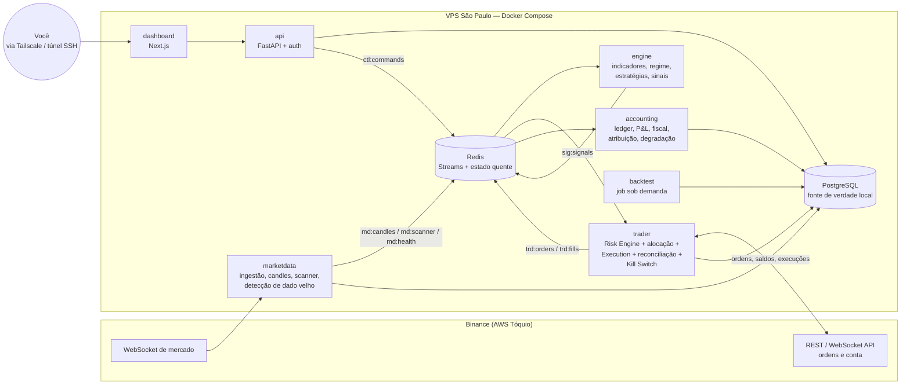

# 01 — Arquitetura

## Escopo fixado (Fase 1)
- **Exchange:** Binance, somente **spot**, pares cotados em **USDT** (mais liquidez). Sem margem, sem futuros, sem alavancagem.
- **Contribuinte:** pessoa física residente no Brasil. Contabilidade em BRL, com conversão registrada em cada execução.
- **Infra:** uma VPS Linux em São Paulo rodando Docker Compose.
- **Capital inicial:** parâmetro de configuração (`CAPITAL_INICIAL`), ainda não informado.

## Princípios
1. **Fail-closed.** Na dúvida, o sistema não abre posição. Isso vale para estado desconhecido, dado velho, falha de leitura do kill switch ou perda de conexão.
2. **A exchange é a verdade final.** O estado local é cache. Depois de qualquer reconexão, o sistema reconcilia antes de voltar a operar.
3. **Escritor único de ordens.** Só o serviço `trader` fala com os endpoints de ordem, e toda ordem passa pelo Risk Engine dentro desse mesmo processo, de forma síncrona e sem possibilidade de bypass (ver ADR-002).
4. **Determinismo.** Mesma entrada, mesma decisão. Estratégias e regime são funções puras, versionadas e sem IA generativa.
5. **Um código para os três estágios.** Backtest, paper e live usam as mesmas estratégias, o mesmo risco e a mesma contabilidade. Muda só o `ExchangeGateway` e o `Clock` (ver ADR-004).
6. **Dinheiro em `Decimal`** e no banco como `NUMERIC(38,18)`. Nunca `float` em preço, quantidade ou saldo.
7. **Tempo em UTC** (`timestamptz`). Relatórios e apuração fiscal mensal em `America/Sao_Paulo`.
8. **Auditoria append-only.** Decisões, ordens e comandos administrativos ficam gravados em log com hash encadeado.

## Diagrama

## Modos de operação
| Modo | Dados | Ordens | Liberação |
|---|---|---|---|
| `backtest` | Históricos (Postgres e cache Parquet) | Simulador com custos e slippage | Livre |
| `paper` | Ao vivo da Binance | `PaperGateway`: preenchimento simulado contra o book real, com parciais e latência | Sua liberação explícita |
| `live` | Ao vivo da Binance | `BinanceGateway` | Sua liberação explícita, por estratégia, com TOTP |

O modo vale **por estratégia** e fica em `strategy_stage`. Nenhum código promove uma estratégia de estágio sozinho.

## Premissas de latência (e onde Python + VPS deixam de bastar)
- O matching engine de spot da Binance roda em Tóquio. Uma VPS em São Paulo fica a cerca de 250–300 ms de RTT. Ordem REST mais confirmação levam cerca de 300–600 ms. Isso atende o alvo de "centenas de ms a segundos".
- **Consequências:**
  - As estratégias trabalham com candles de **1m ou mais**, de preferência 5m–1h.
  - A estratégia **Liquidity-Based**, que reage ao book, é a mais sensível a essa latência. Ela precisa passar no edge gate *com a latência real modelada*, senão fica fora.
  - Arbitragem e market making competitivo **estão fora do escopo**: exigiriam colocation em Tóquio e outra stack.
  - O relógio precisa estar sincronizado (chrony), por causa do `recvWindow` da Binance e da detecção de dado velho.

## Riscos técnicos abertos
| Risco | Mitigação |
|---|---|
| A API da Binance muda (por exemplo, o stream de dados do usuário) | Consultar a doc oficial na Fase 3. Isolar a Binance atrás do `ExchangeGateway`. |
| CCXT diverge da API nativa em algum endpoint | Testes de contrato com fixtures gravadas. Usar chamada nativa via CCXT `implicit API` quando necessário. |
| Ban por rate limit (HTTP 429/418) | Limitador por peso no gateway, backoff e recuperação do estado via WebSocket. |
| Stop local não executa se o processo cair | Stops **na exchange** (tipos de ordem a confirmar na doc na Fase 8), além do stop lógico. |
| Status fiscal da Binance (nacional ou estrangeira) | Regras fiscais plugáveis (ADR-005). Você confirma com o contador. |
| Meme coins: dados on-chain fora da Binance | Escopo inicial limitado ao que dá para medir na exchange. Fonte on-chain fica pendente. |
| Overfitting | Edge gate com OOS, walk-forward, número mínimo de trades e benchmark BTC. Parâmetros congelados por versão. |
