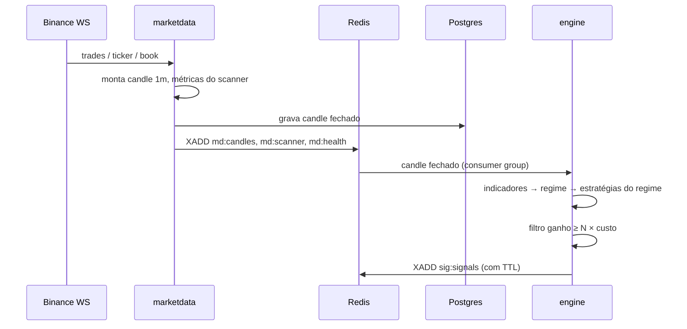
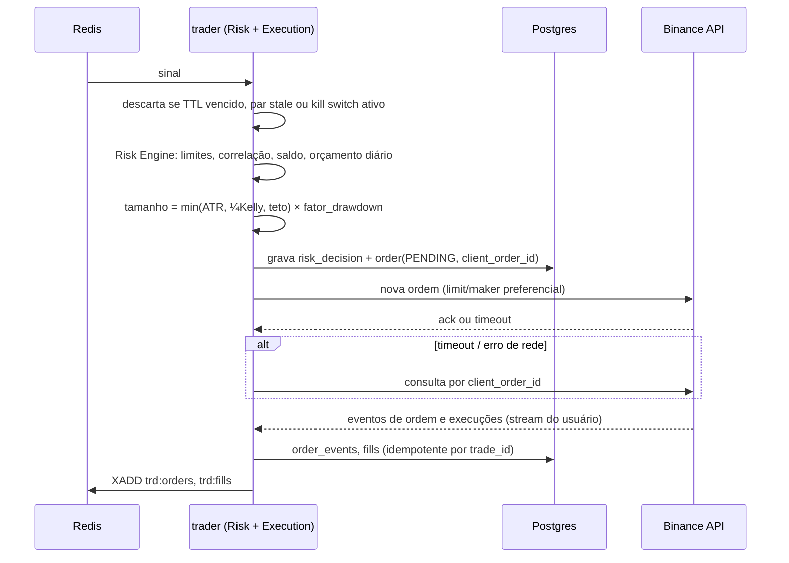
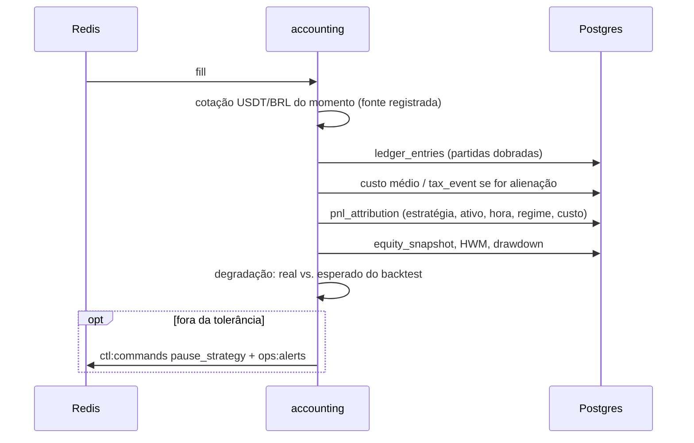
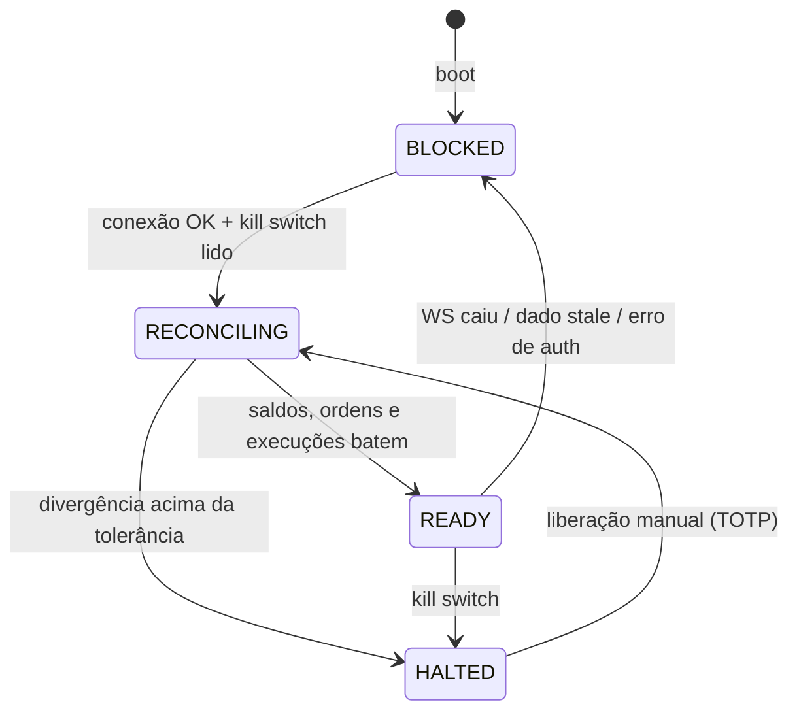
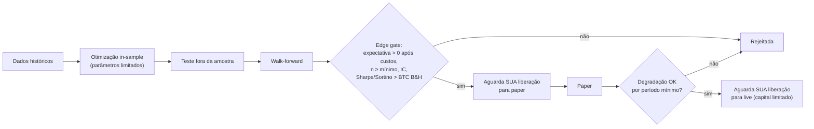

# 04 — Fluxo de dados

## 1. Do mercado ao sinal

## 2. Do sinal à execução (caminho crítico)

**Regra:** uma ordem só conta como executada quando o fill chega da exchange. Ack não é execução.

## 3. Da execução à contabilidade

## 4. Perda de conexão e reconciliação

Em `BLOCKED`, as saídas protetoras já colocadas na exchange continuam valendo. Novas entradas ficam proibidas.

## 5. Kill switch
- **Gatilhos automáticos:** perda diária máxima, drawdown máximo, divergência na reconciliação, erros repetidos da exchange, ban de rate limit.
- **Gatilho manual:** pelo dashboard.
- **Ação padrão:** bloqueia novas entradas, cancela ordens de **entrada** abertas e mantém os stops na exchange.
- `flatten` (zerar posições) é um comando separado e explícito.
- Retomar exige ação manual com TOTP.

## 6. Pipeline de validação da estratégia

