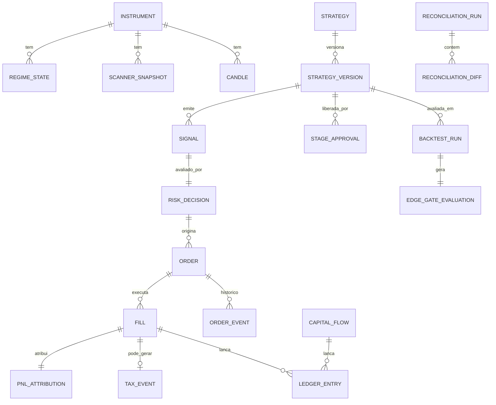

# 05 — Modelo de banco de dados (PostgreSQL 16)

**Convenções:**
- Valores monetários e quantidades em `NUMERIC(38,18)`.
- Datas em `timestamptz` (UTC).
- IDs em `uuid` v7, ordenáveis por tempo.
- Tabelas de eventos são **append-only**. Correções entram como novo evento, nunca como UPDATE.
- Migrações com Alembic.

## Diagrama de relacionamentos (núcleo)

## Tabelas

**Referência e mercado**
| Tabela | Colunas-chave |
|---|---|
| `instruments` | symbol PK, base, quote, status, tick_size, step_size, min_notional, listed_at, is_meme, updated_at |
| `candles` | (symbol, timeframe, open_time) PK, o/h/l/c, volume, quote_volume, trades. Particionada por mês |
| `scanner_snapshots` | ts, symbol, ret_1m/5m/1h, rel_volume, spread_bps, depth_bid/ask_x%, realized_vol |
| `regime_states` | ts, symbol, timeframe, regime, classifier_version, features jsonb |

**Estratégias e validação**
| Tabela | Colunas-chave |
|---|---|
| `strategies` | id, name, allowed_regimes[], description |
| `strategy_versions` | id, strategy_id, version, params jsonb, params_hash, code_hash, created_at |
| `backtest_runs` | id, strategy_version_id, data_range, data_hash, cost_model jsonb, latency_model, metrics jsonb, oos_metrics, wf_folds jsonb, n_trades, benchmark_metrics, seed |
| `edge_gate_evaluations` | backtest_run_id, passed, criteria jsonb (cada critério: valor, limite, ok) |
| `strategy_stage` | strategy_version_id, stage (`backtest`, `paper`, `live`, `paused`, `retired`), since |
| `stage_approvals` | id, strategy_version_id, from_stage, to_stage, approved_by, approved_at, totp_verified, note |

**Sinais, risco e execução**
| Tabela | Colunas-chave |
|---|---|
| `signals` | id, strategy_version_id, symbol, side, ref_price, stop, target, exp_edge_bps, est_cost_bps, regime, features jsonb, ttl_ms, created_at |
| `risk_decisions` | id, signal_id, approved, reasons[], size_atr, size_kelly, size_cap, dd_factor, final_qty, limits_snapshot jsonb |
| `orders` | id, client_order_id UNIQUE, exchange_order_id, risk_decision_id, mode (`paper`/`live`), symbol, side, type, tif, price, qty, status, created_at |
| `order_events` | id, order_id, status, payload jsonb, source (`exchange`/`local`), ts |
| `fills` | id, (exchange, trade_id) UNIQUE, order_id, price, qty, quote_qty, fee, fee_asset, is_maker, ts, brl_rate, brl_rate_source, slippage_bps |
| `kill_switch_events` | id, state, trigger, actor, reason, ts |
| `risk_limits` | version, config jsonb, active_from, set_by |

**Portfólio e reconciliação**
| Tabela | Colunas-chave |
|---|---|
| `balance_snapshots` | ts, asset, free, locked, source (`exchange`/`ledger`) |
| `reconciliation_runs` / `_diffs` | id, ts, status; asset/order, expected, actual, delta |

**Contabilidade e fiscal**
| Tabela | Colunas-chave |
|---|---|
| `ledger_entries` | id, tx_id, account, asset, amount (±), kind (`trade`/`fee`/`deposit`/`withdrawal`/`transfer`), ref_fill_id, ts. A soma por tx_id é zero |
| `capital_flows` | id, kind (aporte/saque), asset, amount, brl_value, ts. **Nunca é lucro** |
| `equity_snapshots` | ts, equity_usdt, equity_brl, hwm, drawdown, btc_bh_equity |
| `avg_cost_state` | asset, qty, avg_cost_brl, updated_at (custo médio corrente) |
| `tax_events` | id, fill_id, asset, qty, proceeds_brl, cost_brl, fees_brl, gain_brl, competence_month, rule_set |
| `tax_monthly_summary` | month, rule_set, total_sales_brl, net_gain_brl, estimated_tax_brl, status |
| `tax_rule_sets` | name, version, params jsonb (isenção, alíquotas, fonte de câmbio), active |
| `pnl_attribution` | fill_id/trade_id, strategy_version_id, symbol, hour_sp, regime, gross, fees, slippage, tax_est, net |
| `performance_fee_config` | enabled = false (padrão), params |

**Operação e segurança**
| Tabela | Colunas-chave |
|---|---|
| `audit_log` | id, ts, actor, action, payload jsonb, prev_hash, hash (cadeia verificável) |
| `alerts` | id, ts, severity, source, message, ack_at |
| `admin_users` | id, username, password_argon2, totp_secret_enc, created_at |
| `used_nonces` | nonce PK, ts (proteção contra replay; TTL) |
| `processed_events` | consumer, event_id PK (deduplicação dos streams) |

**Papéis no banco** (schema `q1`, implementados na Fase 2, ADR-007):
- `q1_migrator`: dono do schema; só o job `migrate` usa.
- `q1_trader`: escreve ordens e execuções.
- `q1_accounting`: escreve o ledger e as tabelas fiscais.
- `q1_api`: somente leitura (`default_transaction_read_only`), mais INSERT explícito em `audit_log` e `used_nonces`.
- `q1_marketdata`: escreve candles e snapshots.
- `q1_engine`: lê mercado e grava sinais.
